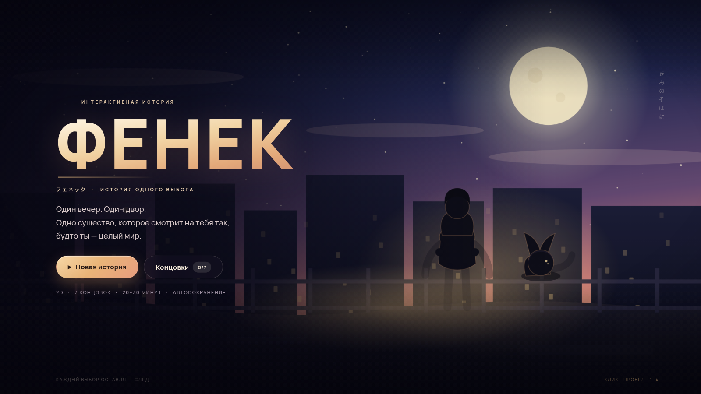
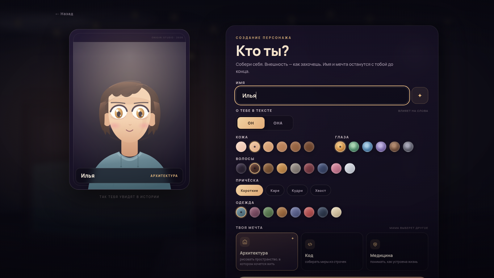
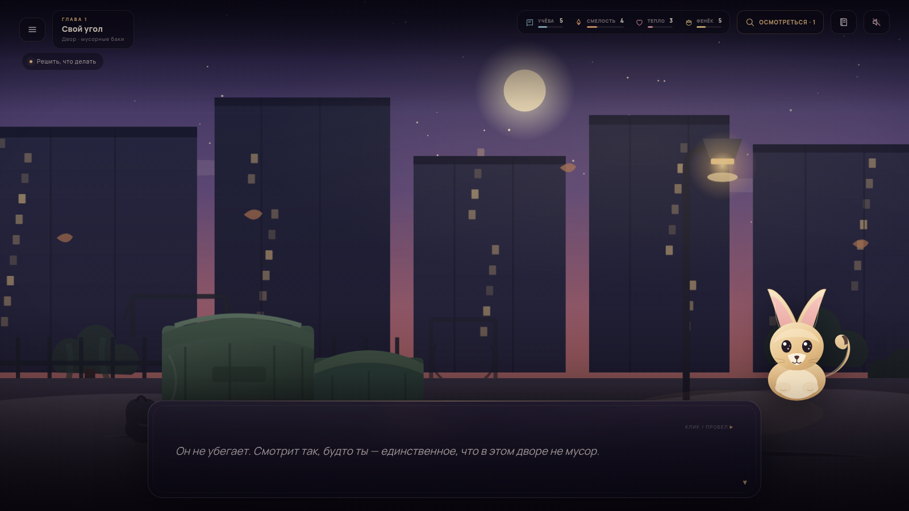
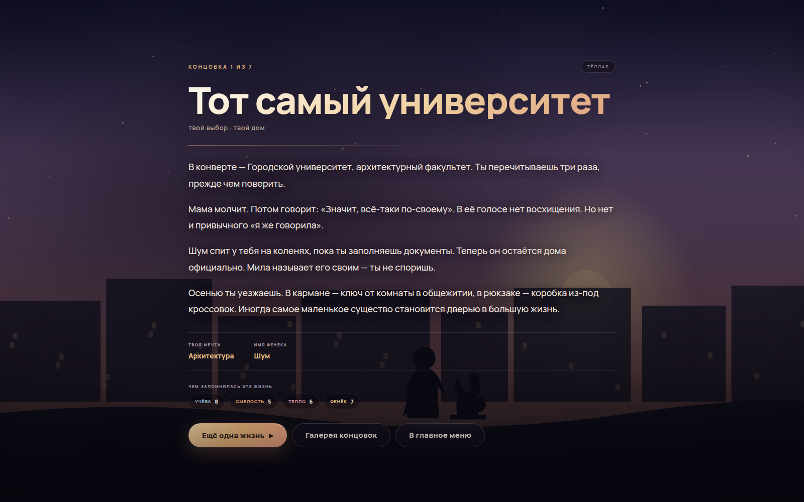

# ФЕНЁК — 2D аниме-новелла

История о подростке, строгих родителях, младшем брате, приёмной сестре и феньке,
найденном у мусорных баков. Один выбор — забрать его или оставить — меняет всё.

Игра сделана на чистом HTML/CSS/JS. Все фоны и портреты — рисованный SVG, без
внешних картинок и библиотек. Звук — процедурный WebAudio.

## Запуск

Самый простой способ:

```bash
# открыть index.html двойным кликом
# или запустить локальный сервер:
python3 -m http.server 8080
# затем открыть http://localhost:8080
```

Никаких сборок и зависимостей не нужно. Игра работает и через `file://`.

## Что внутри

- **Создание персонажа**: имя, форма обращения, кожа, глаза, волосы, причёска,
  одежда и мечта (архитектура / код / медицина). Портрет обновляется вживую.
- **Четыре характеристики**: учёба, смелость, тепло, связь с фенеком. Они влияют
  на концовку.
- **Две большие ветки**: забрать фенька домой или оставить у баков. В каждой —
  свои сцены, выборы, тайны и последствия.
- **7 концовок** и галерея: открытые истории сохраняются между запусками.
- **Монтаж недели**: выбрать 3 вечера перед экзаменом из 5 занятий.
- **Осмотреться**: дополнительные предметы в комнате, на кухне, во дворе, в
  классе и гостиной. Небольшие бонусы к характеристикам и атмосферные детали.
- **Журнал**, автосохранение, продолжение с места, звук и адаптивная мобильная
  вёрстка.
- **Аниме-портреты** с несколькими выражениями лиц и фенёк, который реагирует
  на сцены.

## Управление

| Действие | Клавиша / жест |
|---|---|
| Продолжить диалог | клик по реплике, `Пробел` или `Enter` |
| Пропустить печать текста | клик / `Пробел` |
| Выбрать вариант | клик или цифры `1–4` |
| Пауза / меню | `Esc` или кнопка ☰ |
| Закрыть панель | `Esc` |

## Концовки

- «Тот самый университет» — тёплая
- «Один на сцене» — светлая
- «Со второй попытки» — янтарная
- «Маленький тёплый дом» — тёплая
- «Тихая комната» — тихая
- «Не та дверь» — тихая
- «Свой маршрут» — янтарная

Галерея открывается с титульного экрана и после финала. Уже открытые концовки
показывают тот текст, с которым вы их прошли (имя, мечта, имя фенека).

## Скриншоты






## Структура

```
index.html          — экраны игры
css/style.css       — аниме-UI, адаптив, анимации
js/art2d.js         — SVG-портреты, фоны, титульная иллюстрация
js/story.js         — вся ветвящаяся история и концовки
js/app.js           — движок новеллы, сохранения, статистика, галерея
js/audio.js         — процедурный эмбиент и звуки
assets/fonts/       — Manrope (кириллица + латиница)
screenshots/        — скриншоты игры
```

## Технические заметки

- Сохранение: `localStorage` (`fennek2d_save_v1`).
- Открытые концовки: `localStorage` (`fennek2d_endings_v1`).
- Звук по умолчанию включён; первый жест запускает AudioContext.
- Есть dev-параметры для отладки: `?dev=creator`, `?dev=game&node=ch1_yard`,
  `?dev=ending&id=warm_uni`, `?dev=gallery`, `?mute=1`, `?instant=1`, `?nocard=1`.
